<div align="center">

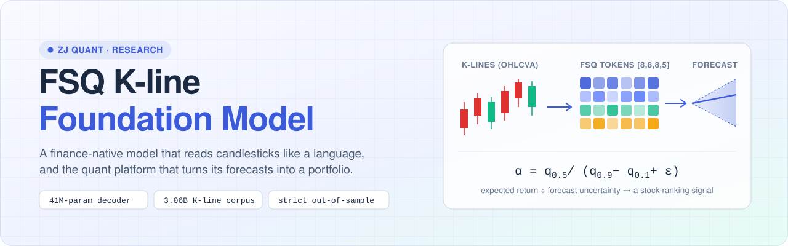

<p><b>English</b> &nbsp;|&nbsp; <a href="README.zh-CN.md">简体中文</a></p>

<a href="#results"></a>


<br><br>

<a href="#overview"><b>Overview</b></a> &nbsp;·&nbsp;
<a href="#the-idea-in-one-minute"><b>The idea</b></a> &nbsp;·&nbsp;
<a href="#system-architecture"><b>Architecture</b></a> &nbsp;·&nbsp;
<a href="#inside-the-fsq-model"><b>Model</b></a> &nbsp;·&nbsp;
<a href="#results"><b>Results</b></a> &nbsp;·&nbsp;
<a href="#risk-management"><b>Risk</b></a> &nbsp;·&nbsp;
<a href="#the-research-platform"><b>Platform</b></a> &nbsp;·&nbsp;
<a href="#getting-started"><b>Get started</b></a>

</div>

<br>

> **FSQ** is a foundation model pre-trained from scratch on Chinese stock candlestick data. It turns every daily bar into a discrete token with
> *Finite Scalar Quantization*, learns how these tokens follow one another, and forecasts a **range** of 10-day returns in a single pass.
> The forecast becomes a stock-selection factor that is evaluated, risk-managed and traded inside **ZJ Quant**, a containerised
> multi-factor research platform with a data layer, a factor engine, a research console and an observability layer.

## Overview

This repository contains two systems that run side by side and share one data and factor contract.

| | What it is | Where |
| :-- | :-- | :-- |
| 🧠 **FSQ engine** *(core)* | K-line tokenizer, autoregressive foundation model, quantile forecasting head, risk-adjusted factor, portfolio construction and risk control, plus Qlib and SuperMind backtests | [`packages/fsq_kbar`](packages/fsq_kbar) |
| 🏗️ **ZJ Quant platform** | Governed point-in-time data lake, factor library and evaluation engine, research console, observability. FSQ enters it as two first-class factors | [`apps/`](apps) · [`packages/quant_*`](packages) |

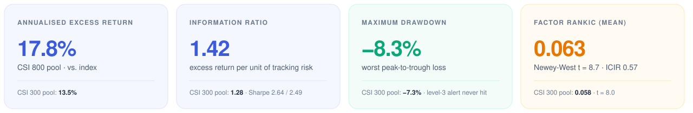

<sub>Strictly out of sample. The model never saw data after 2025-06-30, and the test runs from 2025-07-01 to 2026-06-18 (235 trading days). Returns are net of a 0.15 % one-way trading cost. Benchmarks are the CSI 300 and CSI 800 indices. Full protocol in <a href="#results">Results</a>.</sub>

## The idea in one minute

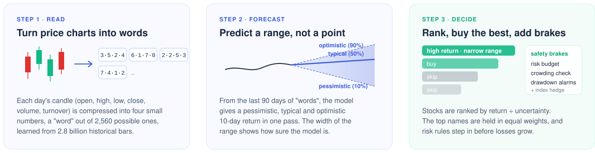

Most quantitative stock-selection signals are hand-written formulas, such as "20-day momentum" or "price-to-book". They capture only a sliver of what a price chart contains.
General-purpose time-series foundation models learn patterns automatically, but less than about 1 % of their training data is financial, so they transfer poorly to noisy, fat-tailed stock prices.

FSQ treats candlesticks as a language. It first learns a compact vocabulary of bar shapes, then learns the "grammar" of how bars follow one another across every Shanghai and Shenzhen A-share since 2005.
For each stock and day it gives a **pessimistic, typical and optimistic** 10-day outcome. Stocks whose typical outcome is high **and** whose range is narrow rank first, because the model is both optimistic and confident about them.
The rest of the system decides how much to hold and when to step on the brakes.

### Highlights

- **Finance-native pre-training.** 100 % financial corpus: 3.06 billion raw K-lines across 7 frequencies (1-minute to weekly), including 5,872 delisted stocks to avoid survivorship bias.
- **FSQ parallel tokenization.** Four bounded scalars with levels `[8, 8, 8, 5]` give 2,560 implicit states with **no codebook**, so codebook collapse cannot happen. Limit-up/down bars, gaps and volume spikes map to edge levels instead of being flattened. 71.4 % of joint states are used, with normalised entropy 0.87.
- **Four small classifiers instead of one big vocabulary.** The decoder predicts 8 + 8 + 8 + 5 = **29** classes per step instead of 2,560, in one backbone pass.
- **Deterministic quantile inference.** A monotone quantile head emits q0.1 / q0.5 / q0.9 in one forward pass. There is no Monte-Carlo sampling, so inference over the whole pool is about 80 % faster than 5-path sampling. The 80 % band covers 78.6 % of realised outcomes.
- **Forecast uncertainty drives risk.** The forecast band width is mapped to forward volatility (isotonic calibration, frozen out of sample) and feeds a volatility budget, a drawdown ladder and an index-futures hedge ladder.
- **Audit-grade evaluation.** Strict time isolation, identical protocol for every baseline, costs charged up front, and a yearly walk-forward with full retraining from 2017.
- **Engineered as a system.** Six Docker services, a single-writer parquet lake with point-in-time reads, a factor queue with memory admission control, and end-to-end tracing.

## System architecture

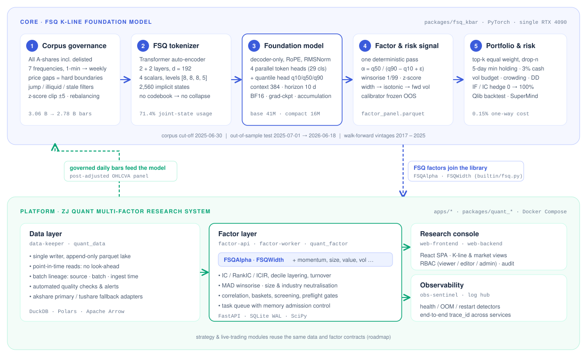

The **FSQ engine** (top) is the research core. It trains offline on a single GPU and writes a factor panel.
The **platform** (bottom) supplies governed market data to the engine. It loads the panel through the [`FSQAlpha` / `FSQWidth`](packages/quant_factor/src/quant_factor/builtin/fsq.py) builtins, so FSQ is evaluated, neutralised and correlated against classic factors with the same machinery and the same audit trail.

<details>
<summary><b>Service topology</b> (six containers, one public port)</summary>

| Service | Role | Storage |
| :-- | :-- | :-- |
| `web-frontend` | nginx: React SPA + reverse proxy, the only public entry | — |
| `web-backend` | gateway, auth (JWT + RBAC), audit, log hub, read console, monitor evaluator | `/data:ro`, `./state` |
| `data-keeper` | **single writer**: ingest API, in-process job runner and scheduler, reconcile/reaper | `/data:rw` |
| `factor-api` | factor library, runs, baskets, screening | `/data:ro`, `./factor-store` |
| `factor-worker` | evaluation queue: IC/IR, layering, neutralisation, correlation | `/data:ro`, `./factor-store` |
| `obs-sentinel` | out-of-process watchdog: liveness, OOM, restart storms, disk, CPU, core dumps | `docker.sock:ro` |

Reads go straight to the library over read-only parquet. Writes go through one service. A `trace_id` follows every request across services into a single log hub.

</details>

## Inside the FSQ model

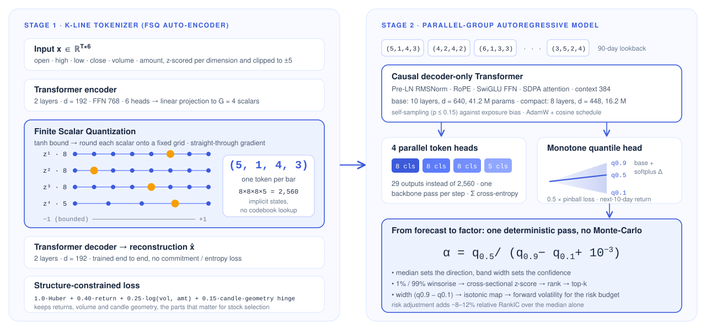

### Why scalar quantization

| | Learned-codebook tokenizers (VQ / BSQ, hierarchical) | **FSQ, parallel groups (this work)** |
| :-- | :-- | :-- |
| Discrete states | learned codebook + nearest-neighbour lookup | implicit Cartesian grid: 8 × 8 × 8 × 5 = 2,560 |
| Auxiliary losses | commitment and entropy terms, at risk of codebook collapse | none, so collapse is ruled out by construction |
| Extreme bars | outliers pulled to the nearest code | bounded `tanh` maps them to edge levels, keeping their shape |
| Token structure | coarse → fine, decoded sequentially | 4 symmetric sub-tokens predicted **in parallel** from one hidden state |
| Prediction head | one softmax over the full vocabulary | 4 heads, **29 classes** in total; depth does not grow with capacity |
| Inference | Monte-Carlo paths, averaged | one deterministic pass, quantiles out directly |

**Choosing the state space** (earlier benchmark-dataset experiments):

| Config | Levels | States | Recon. NRMSE ↓ | Factor RankIC ↑ | Inference time |
| :-- | :-- | --: | --: | --: | --: |
| FSQ-S | `[8, 8, 8]` | 512 | 0.086 | 0.041 | 1.00× |
| **FSQ-B (used)** | **`[8, 8, 8, 5]`** | **2,560** | **0.078** | **0.047** | **1.07×** |
| FSQ-L | `[8, 8, 6, 5, 5]` | 9,600 | 0.074 | 0.048 | 1.15× |

A fourth scalar buys most of the gain. A fifth adds little accuracy and twice the extra cost.

**Token usage on the training corpus:** 100 % of levels used in every dimension, mean normalised entropy 0.87, 71.4 % of the 2,560 joint states active, top-10 % states carry 46.2 % of bars, and no degenerate dimension.

### Model family

| Model | Layers | d_model | FFN | Heads | Parameters | Learning rate | Weight decay | Dropout (ffn / resid / attn / token) |
| :-- | --: | --: | --: | --: | --: | --: | --: | :-- |
| Tokenizer | 2 + 2 | 192 | 768 | 6 | 1.78 M | 3e-4 | 0.01 | — |
| **FSQ-compact** | 8 | 448 | 1,344 | 7 | 16.18 M | 8e-4 | 0.02 | 0.15 / 0.15 / 0.10 / 0.05 |
| **FSQ-base** | 10 | 640 | 1,920 | 10 | 41.15 M | 5e-4 | 0.05 | 0.10 / 0.10 / 0.05 / 0.00 |

<sub>Parameter counts are as built by <code>kbarfm.model.build_model</code>. Context is 384 steps, the forecast horizon is H = 10 days and the inference lookback is 90 days. Training uses AdamW with 1,500 warm-up steps followed by a cosine schedule.
The objective is Σ group cross-entropy + 0.5 × pinball loss, with self-sampling ramped to p = 0.15 over 60k steps.</sub>

### Training

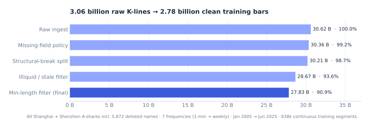

| Stage | Steps | Batch × context | Volume | Wall-clock | Peak memory |
| :-- | --: | :-- | :-- | --: | --: |
| Tokenizer | 200,000 | 256 × 128 | ≈ 6.55 B bars seen | ≈ 8.7 h | 9.8 GB |
| Pre-training · compact | 120,000 | 16 × 384 (accum. 4) | ≈ 0.74 B tokens | ≈ 4.6 h | 12.6 GB |
| Pre-training · base | 120,000 | 16 × 384 (accum. 4) | ≈ 0.74 B tokens | ≈ 8.9 h | 22.3 GB |
| Out-of-sample factor generation | — | 256 (inference) | ≈ 187k stock-days | ≈ 1.6 h | 6.4 GB |
| **Total** | | | | **≈ 24 GPU·h** | |

<sub>Everything runs on one RTX 4090 / 4090D (24 GB) in a CUDA 12.6 container with PyTorch 2.7.0. BF16, gradient checkpointing, SDPA attention and gradient accumulation fit the base model on a consumer card.
The global seed is 42 and key metrics vary by less than ±0.2 % across repeated runs. The base model's validation loss falls from 7.85 to about 4.51 (compact: about 4.74) with a small train/validation gap.</sub>

## Results

**Protocol.**

- The pre-training corpus ends on 2025-06-30, and the test window runs from 2025-07-01 to 2026-06-18. No parameter is tuned on the test window.
- Every model and baseline uses the same universe, rules and costs:
  - CSI 300 and CSI 800 constituents, with suspended, ST and limit-locked stocks filtered out;
  - long-only, equal-weight top-k (k = 50 / 200) with drop-n (n = 5 / 10);
  - a rebalance every 5 days and a 5-day minimum holding period;
  - a 0.15 % one-way cost;
  - simulation in Qlib.
- Factors use post-adjusted prices, while fills use real prices.

| Metric | CSI 300 pool | CSI 800 pool |
| :-- | --: | --: |
| Cumulative return (benchmark) | **+38.3 %** (+26.0 %) | **+44.9 %** (+28.7 %) |
| Annualised excess return (AER) | **13.5 %** | **17.8 %** |
| Information ratio | 1.28 | 1.42 |
| Sharpe ratio (rf = 2 %) | 2.49 | 2.64 |
| Maximum drawdown | −7.3 % | −8.3 % |
| Calmar ratio | 5.70 | 5.89 |
| Monthly win rate (excess) | 66.7 % | 75.0 % |
| Factor RankIC mean · ICIR · Newey-West t | 0.058 · 0.52 · 8.0 | 0.063 · 0.57 · 8.7 |
| Share of days with positive RankIC | 68.4 % | 71.1 % |

### Against other forecasting models

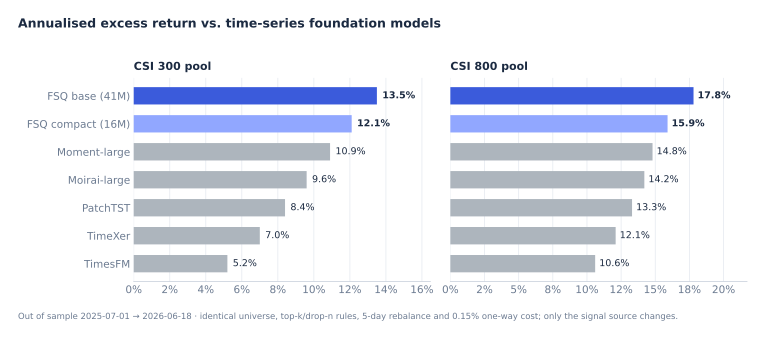

Moment, Moirai and TimesFM run with their official pre-trained weights. PatchTST and TimeXer are trained on the same training window. Only the signal source changes.
The base model beats the compact one on both pools, which is consistent with scaling behaviour.

### Across market regimes

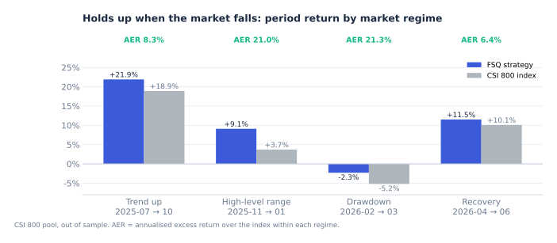

Excess return is positive in all four regimes of the test year. It is largest when stocks diverge (sideways and falling markets), which is where price-volume information is densest. In the February–March drawdown the strategy lost 2.3 % against the index's 5.2 %.

### Across nine years: walk-forward retraining

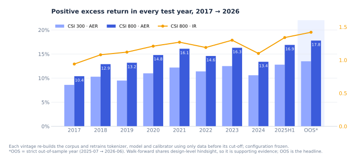

How each vintage was built:

- One model vintage per year (2017–2025), each trained only on data up to the end of the previous year.
- Each vintage re-runs the whole chain: corpus, tokenizer, foundation model, quantile head and volatility calibrator.
- Configuration is frozen across vintages, with zero yearly tuning.

What it shows:

- Over 2017-01 to 2025-06 the annualised excess return is **11.2 %** (CSI 300) and **14.4 %** (CSI 800), with IR 1.03 / 1.19.
- Excess return is positive in every test year, through the 2018 bear market, the 2021 style rotation and the 2024 small-cap liquidity shock.

### Where the excess return comes from

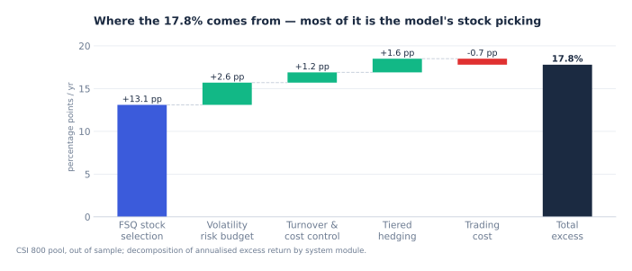

### Robustness checks

- **Factor quality.**
  - Decile portfolios are strictly monotone: top decile +19.8 % and bottom decile −13.2 % annualised excess, a long-short spread of about 33 pp.
  - RankIC peaks at H = 10 days (0.063) and is still 0.041 at H = 20.
- **Trading cost.**
  - Doubling the one-way cost to 0.30 % still leaves 12.6 % / 17.1 % AER.
  - The break-even one-way cost is about 2.3 % / 4.0 %, far above institutional costs in A-shares.
- **Portfolio parameters.** AER changes by less than about 2 pp across neighbouring settings of k and rebalance frequency. The baseline sits on a broad plateau, not a spike.
- **Factor construction.**
  - Dividing by the q0.9 − q0.1 band adds about 8–12 % relative RankIC over using the median alone.
  - Narrower (q0.25 / q0.75) or wider (q0.05 / q0.95) bands are both worse.

### Limitations

- The strict out-of-sample window is one year (235 trading days) and does not span a full bull–bear cycle.
- The walk-forward is **quasi-out-of-sample**. Each vintage respects data cut-offs, but the architecture and hyper-parameters were chosen after seeing the full history. It is supporting evidence, not the headline.
- Figures marked as *earlier experiments* (state-space trade-off, benchmark-dataset IC) come from a separate historical benchmark dataset and are not directly comparable with the out-of-sample numbers.
- The model uses price and volume only. Fundamentals, industry structure and news are natural next inputs.

## Risk management

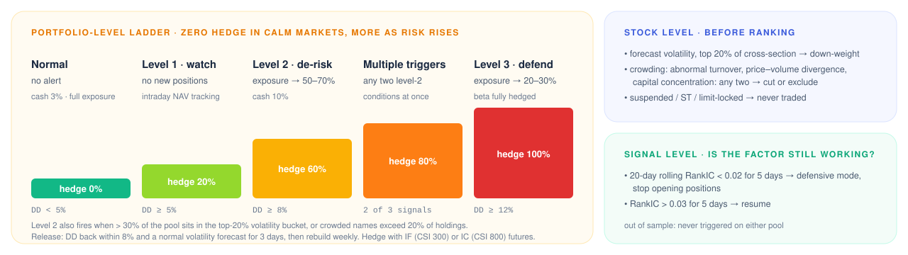

Risk control acts at three levels: stock, portfolio and signal.

- Forecast volatility comes from the same forward pass as the factor, so the risk budget is set **before** positions are opened rather than after losses appear.
- Out of sample, the CSI 300 portfolio entered the level-1 watch zone 3 times and never reached level 2.
- The CSI 800 portfolio touched level 2 for a single day in December 2025 and recovered after de-risking.
- Level 3 was never reached on either pool.

## The research platform

The FSQ factors live in the same console as every other factor in the library, next to market data, data-quality tooling and live system health.
The UI is a dense, keyboard-driven light theme, available in English and Chinese.

<table>
<tr>
<td colspan="2">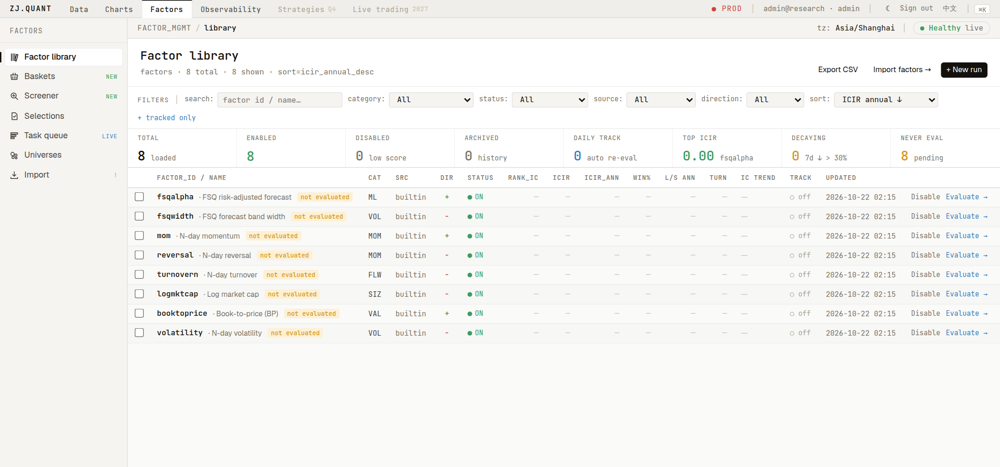<br><sub><b>Factor library.</b> <code>fsqalpha</code> and <code>fsqwidth</code> are registered as builtins next to the classic factors. Every factor gets the same columns: RankIC, ICIR, win rate, long-short return, turnover, decay and daily tracking.</sub></td>
</tr>
<tr>
<td width="50%">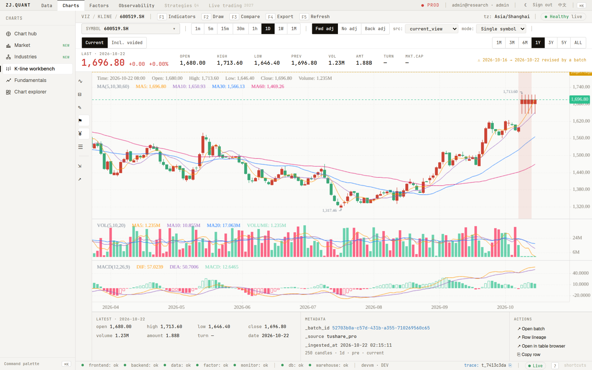<br><sub><b>K-line workbench.</b> Multi-frequency candles, adjustment modes, indicators and per-bar lineage (batch, source, ingest time).</sub></td>
<td width="50%">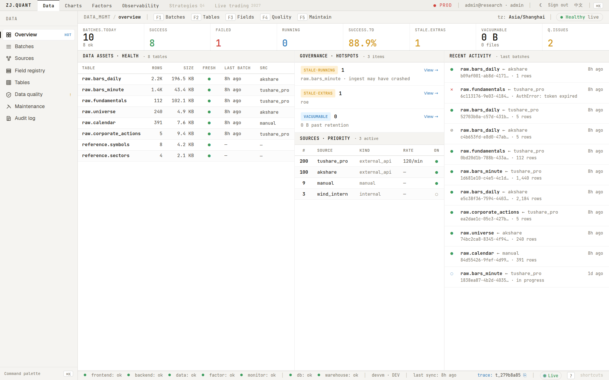<br><sub><b>Data governance.</b> Table health, batch ledger, source priority and governance hotspots.</sub></td>
</tr>
<tr>
<td width="50%">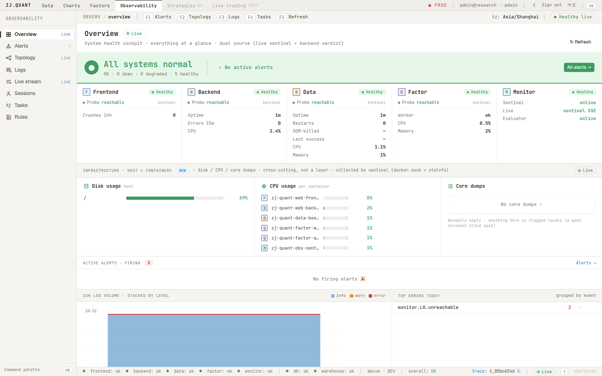<br><sub><b>Observability.</b> Layer health, host resources, crash-dump watch and alert lifecycle.</sub></td>
<td width="50%">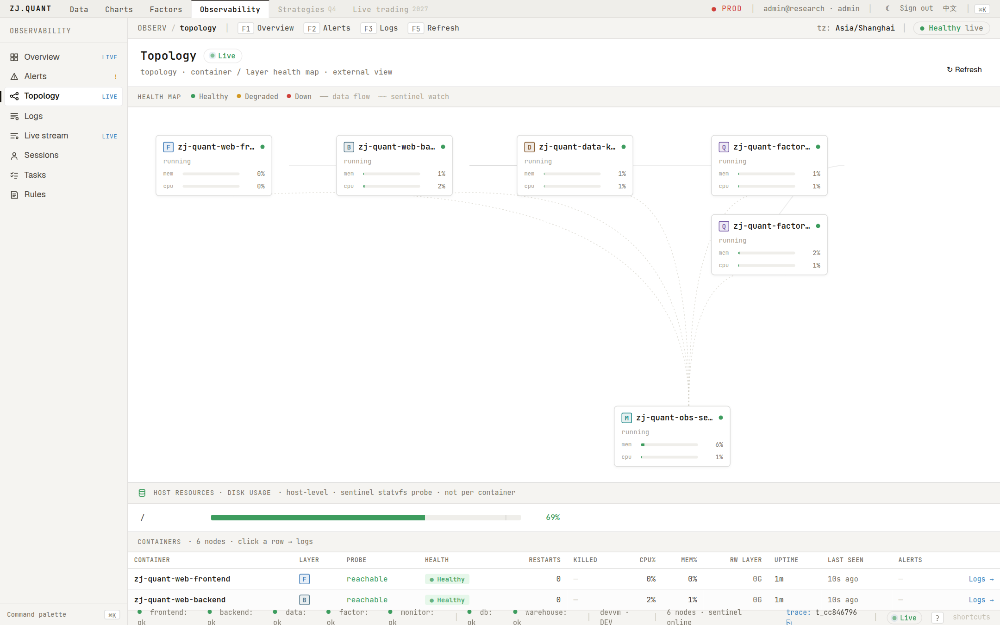<br><sub><b>Topology.</b> Live container map from the out-of-process sentinel.</sub></td>
</tr>
</table>

<sub>Screenshots come from a local deployment loaded with the platform's built-in demo dataset, so the values in them are illustrative. Strategy results are reported in <a href="#results">Results</a>.</sub>

## Repository layout

```
ZJ_Quant_03/
├── packages/
│   ├── fsq_kbar/              ★ FSQ engine: kbarfm/ (data · model · train · factor · risk · portfolio · eval)
│   │   ├── scripts/              corpus → tokenizer → pre-train → calibrate → factor → eval → walk-forward
│   │   ├── configs/              every hyper-parameter, one YAML per stage
│   │   ├── supermind/            execution-side strategy (stocks + index futures)
│   │   └── qlib_backtest/        Qlib two-pass risk backtest, attribution, sensitivity
│   ├── quant_factor/          factor contract, evaluation engine, neutralisation, correlation
│   │   └── src/quant_factor/builtin/fsq.py   ← FSQAlpha / FSQWidth
│   ├── quant_data/            point-in-time parquet lake, governance, quality, lineage
│   └── quant_strategy/        strategy library (platform roadmap)
├── apps/
│   ├── data-keeper/           single-writer ingest + scheduler
│   ├── factor/                factor API + worker queue
│   ├── web/                   React console + FastAPI gateway
│   └── obs-sentinel/          out-of-process watchdog
├── deploy/                    docker-compose (prod + dev overlay), .env template
└── assets/readme/             figures in this README (charts rebuilt by src/make_charts.py)
```

## Getting started

There are three ways in, depending on what you want to do:

| I want to… | Path | Needs a GPU? | Time |
| :-- | :-- | :-- | :-- |
| click around the platform with demo data | [A · Run the platform](#a--run-the-platform-with-demo-data) | no | ~15 min (first build) |
| train FSQ and produce my own factor panel | [B · Train the FSQ model](#b--train-the-fsq-model) | yes, NVIDIA 24 GB | ~24 GPU·h end to end |
| read or change the code, run the tests | [C · Develop locally](#c--develop-locally) | no | ~5 min |

### Prerequisites

| | Linux | macOS | Windows |
| :-- | :-- | :-- | :-- |
| **Supported** | x86-64 or arm64, any recent distribution | 12+ on Intel or Apple silicon | 10 (22H2) / 11, through **WSL 2** |
| **Container runtime** | [Docker Engine](https://docs.docker.com/engine/install/) 24+ with the Compose v2 plugin | [Docker Desktop](https://docs.docker.com/desktop/setup/install/mac-install/) 4.25+ | [Docker Desktop](https://docs.docker.com/desktop/setup/install/windows-install/) 4.25+ with the WSL 2 backend |
| **Git** | distribution package | `xcode-select --install` | [Git for Windows](https://git-scm.com/download/win), or Git inside WSL |
| **Path B (training)** | NVIDIA driver 550+ and the [NVIDIA Container Toolkit](https://docs.nvidia.com/datacenter/cloud-native/container-toolkit/install-guide.html) | not supported (no CUDA) | NVIDIA driver 550+ on Windows, [CUDA on WSL](https://docs.nvidia.com/cuda/wsl-user-guide/) |
| **Path C (dev)** | Python 3.11+, Node.js 20+ | Python 3.11+, Node.js 20+ | same, installed inside WSL |

Give Docker at least **4 CPUs, 8 GB of memory and 15 GB of free disk**. Docker Desktop sets these under *Settings → Resources*.
Check your setup before you start:

```bash
docker version            # both Client and Server must answer
docker compose version    # v2.20 or newer
```

> [!TIP]
> **On Windows, work inside WSL 2.** Open an Ubuntu terminal and clone the repository into the Linux file system (for example `~/src`), not under `/mnt/c/`.
> Builds are several times faster there, and every command below then works exactly as on Linux.
> If you prefer PowerShell, the commands are the same apart from the lines marked *PowerShell*.

### A · Run the platform with demo data

**1. Clone the repository.**

```bash
git clone https://github.com/sjbsjb233/ZJ_Quant_03.git
cd ZJ_Quant_03/deploy
```

**2. Create the configuration file.** All settings live in one file, `deploy/.env`, which is ignored by Git.

```bash
cp .env.example .env
```

Open `.env` in any editor and change these lines. Everything else can keep its default.

```ini
WEB_PORT=8080                  # the only port the platform publishes; 80 is often taken on desktops
ALLOWED_ORIGINS=http://localhost:8080
ENVIRONMENT=DEV
JWT_SECRET=<a long random string>
LOG_INGEST_TOKEN=<another long random string>
ENABLE_SCHEDULER=false         # the demo needs no market-data token; leave the scheduler off
```

To generate the two secrets, run `openssl rand -hex 32` (Linux, macOS, WSL) or `[guid]::NewGuid().ToString("N")` (*PowerShell*).

**3. Tell Compose to use the local-build overlay.** This saves typing `-f docker-compose.yml -f docker-compose.dev.yml` on every command.

```bash
export COMPOSE_FILE=docker-compose.yml:docker-compose.dev.yml      # Linux, macOS, WSL
```

```powershell
$env:COMPOSE_FILE = "docker-compose.yml;docker-compose.dev.yml"   # PowerShell (note the ;)
```

**4. Build the images.** The first build downloads base images and Python and Node dependencies and takes 5–15 minutes. Later builds are cached.

```bash
docker compose build
```

**5. Load the demo dataset and the demo users.** Both commands are one-off and idempotent.

```bash
docker compose run --rm data-keeper python -m keeper_service.seed_demo
docker compose run --rm web-backend python -m quant_web.seed_users
```

**6. Start the stack.**

```bash
docker compose up -d
docker compose ps        # wait until every service shows "running" or "healthy" (≈ 30 s)
```

**7. Open the console** at <http://localhost:8080> and sign in as `admin` / `admin123`.
The interface opens in English. The `中文` button in the top bar switches it to Chinese.

<details>
<summary><b>Stop, update, reset</b></summary>

```bash
docker compose stop                   # stop, keep everything
docker compose down                   # remove the containers, keep data (never add -v)
git pull && docker compose up -d --build   # update to the latest code
```

All state lives in five folders under `deploy/`: `data/`, `state/`, `keeper-store/`, `factor-store/` and `logs/`.
Back up or move a deployment by copying `deploy/` after `docker compose down`.
To start from scratch, run `docker compose down`, delete those five folders, and repeat steps 5–6. On Linux they are owned by root, so use `sudo rm -rf`.

</details>

<details>
<summary><b>Troubleshooting</b></summary>

| Symptom | Fix |
| :-- | :-- |
| `bind: address already in use` | Another program owns the port. Change `WEB_PORT` (and `ALLOWED_ORIGINS`) in `.env`. The dev overlay also publishes 8000, 8100 and 8300 for debugging, so free those or remove the `ports:` entries in `docker-compose.dev.yml`. |
| `permission denied … docker.sock` on Linux | Add yourself to the docker group with `sudo usermod -aG docker $USER`, then log out and back in. |
| `exec … no such file or directory` when a container starts on Windows | The scripts were checked out with Windows line endings. Clone inside WSL, or run `git config --global core.autocrlf input` and clone again. |
| A service keeps restarting, or the build is killed | Docker is short of memory. Raise it to 8 GB or more in Docker Desktop. |
| Slow first build in mainland China | Point Docker at a registry mirror, and pip and npm at local mirrors. |

Each service writes structured logs. `docker compose logs -f web-backend` follows one, and the console's **Observability → Logs** page shows all of them joined by `trace_id`.

</details>

### B · Train the FSQ model

Training needs a CUDA GPU. The reference setup is a single RTX 4090 (24 GB) on Linux, or Windows with WSL 2. The pipeline runs in its own container, separate from the platform stack.

**1. Check that Docker can see the GPU.**

```bash
docker run --rm --gpus all nvidia/cuda:12.6.0-base-ubuntu22.04 nvidia-smi
```

**2. Provide the market data.** The pipeline does not download prices. It reads parquet files that you supply:

| Path (under `packages/fsq_kbar/`) | Contents | Used by |
| :-- | :-- | :-- |
| `data/raw/<freq>/<symbol>.parquet` | OHLCV + amount bars for each stock, with `freq` ∈ `1min 5min 15min 30min 60min day week` | corpus, tokenizer, pre-training |
| `data/panel/daily_panel.parquet` | daily long table for the trading universe (post-adjusted) | calibration, factor, evaluation |

Delisted stocks should be included. Date ranges and the corpus cut-off are set in [`configs/`](packages/fsq_kbar/configs).

**3. Run the pipeline.**

```bash
cd packages/fsq_kbar/docker
docker compose build
docker compose run --rm train all          # corpus → tokenizer → pretrain → calibrate → factor → eval
docker compose run --rm train pretrain     # …or one stage at a time
```

Checkpoints go to `checkpoints/` and results to `outputs/`. The factor panel is written to `outputs/factor/factor_panel.parquet`.
Optional steps (yearly walk-forward retraining, the Qlib backtest, the SuperMind execution strategy) are described in [`packages/fsq_kbar/README.md`](packages/fsq_kbar/README.md).

**4. Load the factors into the platform.** Copy the panel into the platform's factor store:

```bash
mkdir -p ../../../deploy/factor-store/fsq
cp ../outputs/factor/factor_panel.parquet ../../../deploy/factor-store/fsq/
```

Alternatively, point the `FSQ_FACTOR_PANEL` environment variable of `factor-api` and `factor-worker` at the file.
`fsqalpha` and `fsqwidth` can then be evaluated on any universe from **Factors → Factor library → Evaluate**.

<details>
<summary><b>No GPU? Check the model on a CPU</b></summary>

The model code runs on a CPU (also on macOS), which is enough to inspect the architecture and run small inference experiments:

```bash
cd packages/fsq_kbar
python3 -m venv .venv && source .venv/bin/activate        # PowerShell: .venv\Scripts\Activate.ps1
pip install torch==2.7.0 --index-url https://download.pytorch.org/whl/cpu
pip install -r requirements.txt
python -c "from kbarfm.model import build_model; print(sum(p.numel() for p in build_model('base').parameters()))"
```

</details>

### C · Develop locally

The Python services and libraries are installed in editable mode into one virtual environment, in dependency order:

```bash
python3 -m venv .venv && source .venv/bin/activate        # PowerShell: .venv\Scripts\Activate.ps1
bash scripts/install_dev.sh                               # on Windows, run this from WSL or Git Bash

# each package carries its own pytest settings, so run tests from inside it
(cd packages/quant_factor && pytest)                      # factor library, including the FSQ builtins
(cd packages/quant_data && pytest)
(cd apps/factor && pytest)
```

Run the console with hot reload against a running stack (path A):

```bash
cd apps/web/frontend
npm ci
npm run dev              # http://localhost:5173; /api is proxied to web-backend on :8000
```

CI runs the same backend tests and a production frontend build on every pull request.

## Contributing

Issues and pull requests are welcome. Work happens on feature branches that are merged into `develop` through pull requests. `main` only receives releases from `develop`.
Please keep pull requests focused, add tests for behaviour changes, and make sure CI is green.

## Roadmap

| Track | Scope | Status |
| :-- | :-- | :-- |
| FSQ engine | tokenizer, foundation model, factor, risk, Qlib/SuperMind backtests, walk-forward | ✅ complete |
| Data layer | governed point-in-time lake, quality, lineage, ingest adapters | ✅ live |
| Factor layer | library, evaluation, neutralisation, correlation, baskets, screening | ✅ live · v0.1 |
| Strategy module | portfolio construction and backtesting inside the platform UI | 🛠️ Q4 2026 |
| Live trading | execution and position / risk monitoring | 🗓️ 2027 |
| FSQ next | larger corpus and model, fundamentals + industry inputs, periodic incremental retraining | 🔬 research |

## Acknowledgements

FSQ builds on ideas from FSQ (Mentzer et al., 2023), Qlib (Yang et al., 2020), RoFormer (Su et al., 2024) and the time-series foundation-model literature (Chronos, TimesFM, Moirai, MOMENT, Time-MoE, Timer, Sundial).

<sub>This repository is research code. Nothing in it is investment advice.</sub>

<br>

<div align="center">
<picture>
  <source media="(prefers-color-scheme: dark)" srcset="assets/zj-logo-dark.svg">
  
</picture>
<br>
<sub><em>From clean data to live alpha.</em></sub>
</div>
