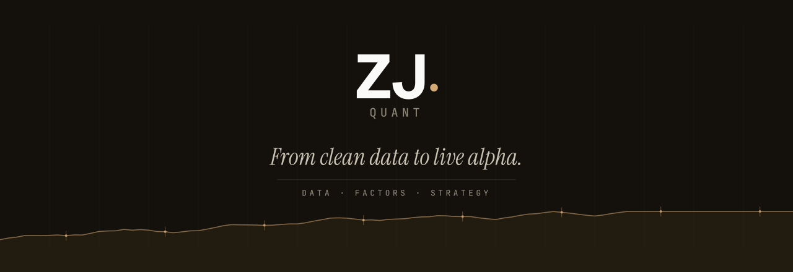
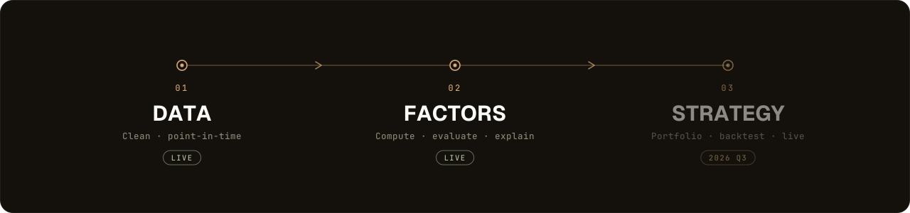

<div align="center">



<br>

<strong>多因子量化投研平台 · 让原始数据，长成可交易的 Alpha</strong>

<br>

<a href="#平台简介--overview"></a>
<a href="#路线图--roadmap"></a>


<br>
<br>

<a href="#平台简介--overview">平台简介</a> &nbsp;·&nbsp; <a href="#为什么是-zj-quant--why-zj-quant">价值主张</a> &nbsp;·&nbsp; <a href="#平台能力--capabilities">平台能力</a> &nbsp;·&nbsp; <a href="#路线图--roadmap">路线图</a> &nbsp;·&nbsp; <a href="#开始使用--get-started">开始使用</a>

</div>

<br>

---

## 平台简介 · Overview

**ZJ Quant** 是一套面向 A 股市场的多因子量化投研平台。

量化投资最难的，从来不是写一个聪明的模型，而是**把每一个数字都变得可信、可复现、可追溯**。ZJ Quant 把这件难而正确的事做成了底座：从杂乱的原始行情与基本面数据出发，沉淀为一座经过治理的「数据资产」，在其之上构建经得起检验的因子，并最终走向可以上线交易的策略。

一句话——**让原始数据，长成可交易的 Alpha。**

<br>

<div align="center">

</div>

<br>

平台围绕三个环环相扣的环节展开，构成一条贯通的研投流水线：**可信的数据 → 经检验的因子 → 可上线的策略**。前两个环节已经上线并持续打磨，策略与实盘环节正在路上。

<br>

## 为什么是 ZJ Quant · Why ZJ Quant

在量化研究里，绝大多数「赚钱的回测」最后没能在实盘兑现，原因往往不在策略本身，而在脚下的数据与流程。ZJ Quant 把投资机构最看重的几件事做成了产品默认值：

### ◆ 数据，可以信任

每一条行情都带有「时间点」属性（Point-in-Time），回测看到的，永远是当时真正能看到的数据——**杜绝未来函数，杜绝偷看明天**。数据只追加、不覆写，任何一个数字都能一路追溯到它的来源、批次与采集时刻。

### ◆ 因子，经得起检验

因子不是一段黑箱代码。在 ZJ Quant 里，每个因子都被注册、版本化，并自动完成 **IC / IR、换手率、分层收益、相关性** 等一整套体检。哪些因子真正有效、彼此是否高度重叠、稳定性如何——一目了然，**可解释、可比较、可复现**。

### ◆ 全程，透明可查

从一条原始数据，到一个因子值，再到一次策略信号，链路上的每一步都有迹可循。数据质量异常、运行任务状态、关键操作记录，都汇聚到统一的看板与审计中枢，**让团队对自己跑出来的每一个结论都心里有底**。

### ◆ 协作，企业级管控

多角色权限（查看 / 编辑 / 管理）、完整的操作审计、单一可信数据源（全系统唯一写入口），让数据资产在团队规模化协作时依然**干净、有序、安全**。

<br>

## 平台能力 · Capabilities

平台以一套精炼、高密度的现代数据工作台呈现，**浅色为主、支持深色**，兼顾日常使用的舒适与专业场景的信息密度。

| 模块 | 你能做什么 |
| :--- | :--- |
| **数据总览 Dashboard** | 一屏掌握数据健康度、关键指标与当日治理热点 |
| **数据质量 Quality** | 自动体检与异常告警，数据问题主动找上门 |
| **行情图表 Charts** | K 线、基本面与自由探索图表，交互式查看任意标的 |
| **因子库 Factor Library** | 因子注册、版本管理与详情评估，研究资产集中沉淀 |
| **因子相关性 Correlation** | 直观呈现因子间的重叠与互补，告别冗余因子 |
| **任务与运行 Runs** | 计算任务排队、调度与全程追踪，跑批进度尽在掌握 |
| **审计与日志 Audit** | 跨层级的操作审计与日志中枢，合规与排障两不误 |

<br>

## 路线图 · Roadmap

我们按「先打地基，再起高楼」的顺序构建平台。地基越扎实，上层的策略与实盘才越可靠。

| 阶段 | 能力 | 状态 |
| :--- | :--- | :---: |
| **数据层 · Data** | 数据治理、质量监控、行情与基本面 | **已上线 · Live** |
| **因子层 · Factors** | 因子库、评估、中性化、相关性分析 | **已上线 · Live** `v0.1` |
| **策略层 · Strategy** | 组合构建、参数搜索、向量化回测、归因 | 规划中 · `2026 Q3` |
| **实盘监控 · Live** | 策略实盘、风险与持仓监控 | 规划中 · Planned |

<br>

## 开始使用 · Get Started

平台完全容器化，**几分钟即可在一台服务器上完整跑起来**——备份与迁移，也只是拷贝一个目录那么简单。

```bash
cd deploy
cp .env.example .env        # 配置访问密钥
docker compose up -d        # 一键启动全部服务
```

启动后即可通过浏览器访问完整的数据与因子工作台。需要演示环境或希望深入了解，欢迎与团队联系。

<br>

## 技术底座 · Under the Hood

平台构建于现代化的高性能数据栈，在保证研究级严谨的同时，兼顾工程级的稳定与速度。

<p>


</p>

<br>

---

<div align="center">

<picture>
  <source media="(prefers-color-scheme: dark)" srcset="assets/zj-logo-dark.svg">
  
</picture>

<br>
<br>

<em>From clean data to live alpha.</em>

<sub>商务与投资合作 · 请联系团队 &nbsp;·&nbsp; © 2026 ZJ Quant</sub>

<!-- 提示：请将上方联系方式替换为你们真实的邮箱 / 链接 -->

</div>
